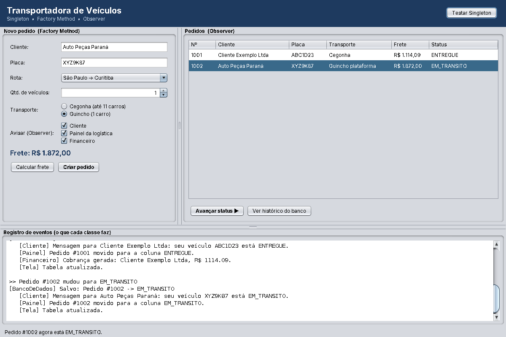
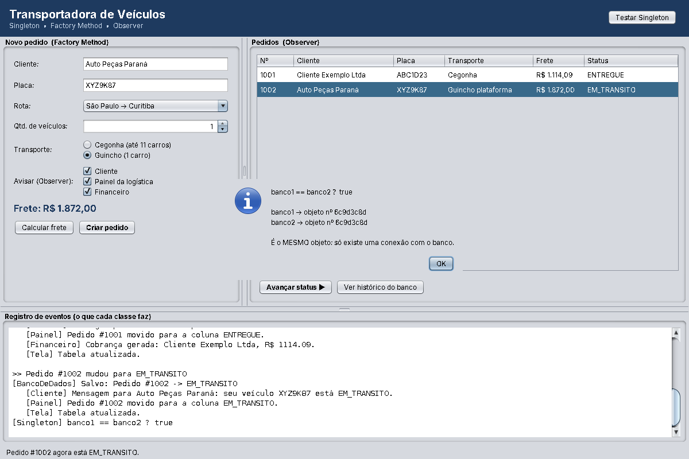
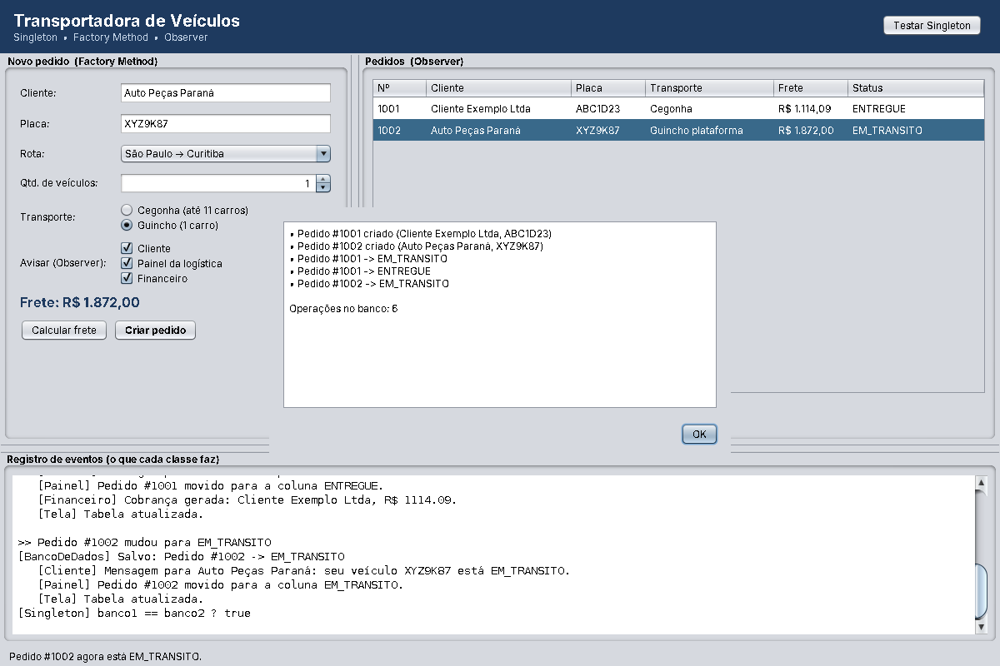
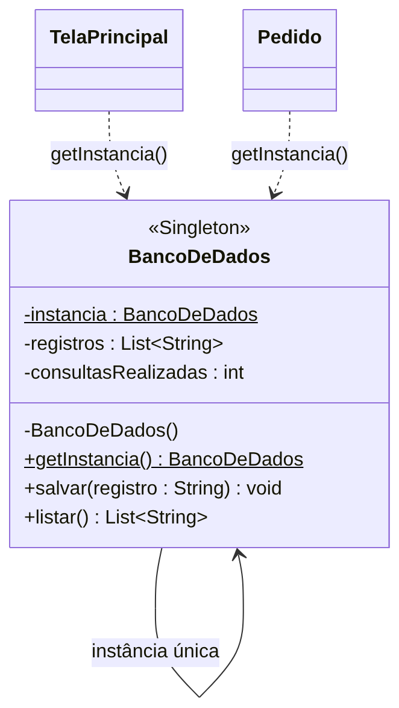
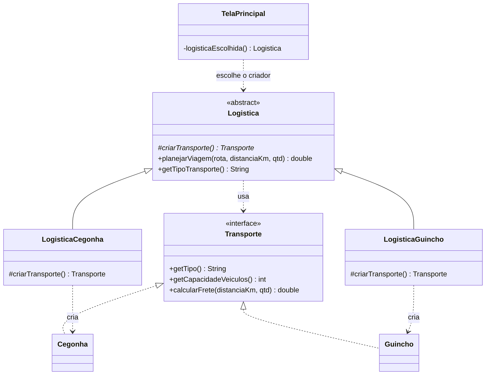
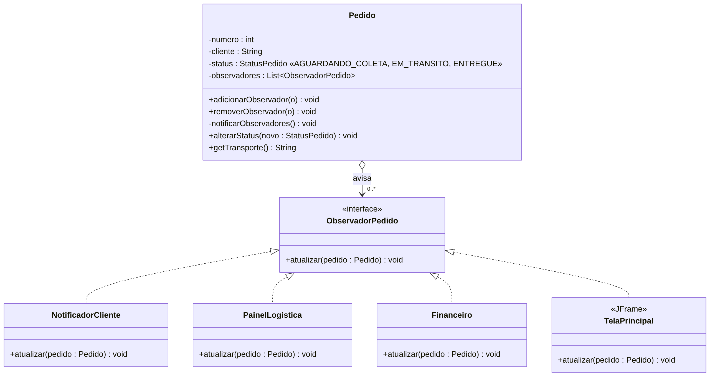

# Introdução

**Projeto:** Sistema de Transporte de Veículos (transportadora com caminhões cegonha), com interface gráfica em Java Swing.

**Problema real:** uma transportadora recebe pedidos de clientes para levar carros de uma cidade a outra. O sistema precisa (1) gravar tudo num único banco de dados, (2) calcular o frete conforme o tipo de caminhão usado e (3) avisar várias áreas (cliente, logística, financeiro e a própria tela) sempre que o pedido muda de situação.

Foram escolhidos **3 padrões de projeto** do catálogo GoF (Gamma et al.): dois criacionais e um comportamental:

| Padrão | Família | Onde foi usado no sistema |
|---|---|---|
| Singleton | Criacional | Conexão única com o banco de dados (`BancoDeDados`) |
| Factory Method | Criacional | Criação do tipo de transporte: cegonha ou guincho (`Logistica`) |
| Observer | Comportamental | Avisos automáticos quando o status do pedido muda (`Pedido`) |

Os três padrões trabalham **juntos** na mesma aplicação: o frete calculado pelo Factory Method vai para o `Pedido`; o `Pedido` (Observer) grava cada mudança no `BancoDeDados` (Singleton) e avisa os observadores, entre eles a própria tela.

Estrutura do código-fonte (Java 11 ou superior, sem bibliotecas externas, arquivos em UTF-8):

```
src/transporte/
 ├─ Main.java                      (abre a tela do sistema)
 ├─ DemoConsole.java               (mesma demonstração, só no console)
 ├─ singleton/BancoDeDados.java
 ├─ factory/Transporte.java, Cegonha.java, Guincho.java,
 │          Logistica.java, LogisticaCegonha.java, LogisticaGuincho.java
 ├─ observer/Pedido.java, StatusPedido.java, ObservadorPedido.java,
 │           NotificadorCliente.java, PainelLogistica.java, Financeiro.java
 └─ tela/TelaPrincipal.java, SaidaParaTela.java
```

# Interface do sistema

Ao executar a classe `Main`, abre-se a tela abaixo. Cada área da tela demonstra um padrão:

- **Novo pedido (Factory Method):** o usuário escolhe *Cegonha* ou *Guincho*; a tela escolhe o criador (`LogisticaCegonha` ou `LogisticaGuincho`) e ele decide qual `Transporte` criar para calcular o frete.
- **Pedidos (Observer):** o botão **Avançar status ▶** muda o status do pedido selecionado; o pedido avisa automaticamente os observadores marcados (Cliente, Painel da logística, Financeiro) e também a própria tela, que atualiza a tabela.
- **Testar Singleton / Ver histórico do banco:** mostram que existe um único objeto `BancoDeDados` e tudo o que foi gravado nele.
- **Registro de eventos:** mostra, em tempo real, as mensagens que cada classe imprime.

{width=100%}

{width=100%}

{width=100%}

# Padrão 1 — Singleton

## Nome / Propósito

**Singleton** (criacional). Garante que uma classe tenha **apenas uma instância** e oferece um **ponto de acesso global** a ela.

## Motivação — Problema / Solução real

**Problema:** várias partes do sistema (tela, pedidos, relatórios, financeiro) precisam acessar o banco de dados. Se cada uma fizesse `new Conexao()`, o sistema abriria dezenas de conexões, gastando memória e podendo estourar o limite de conexões do servidor de banco. Além disso, os dados ficariam espalhados em objetos diferentes.

**Solução:** a classe `BancoDeDados` tem o **construtor privado** (ninguém consegue usar `new`) e um método estático `getInstancia()` que cria o objeto só na primeira chamada e devolve sempre o mesmo objeto nas próximas. O método usa *double-checked locking* com `volatile` para ser seguro mesmo com várias threads.

## Estrutura — Diagrama UML

{width=45%}

**Participantes:** `BancoDeDados` (o Singleton) e os clientes `TelaPrincipal` e `Pedido`, que só obtêm o banco por `getInstancia()`.

## Código

**`src/transporte/singleton/BancoDeDados.java`**

```java
package transporte.singleton;

import java.util.ArrayList;
import java.util.Collections;
import java.util.List;

/**
 * PADRÃO SINGLETON
 * Garante que exista UMA única conexão com o banco de dados em todo o sistema.
 * (Aqui o "banco" é simulado em memória para o exemplo rodar sem instalar nada.)
 */
public final class BancoDeDados {

    // 1) A única instância fica guardada num atributo estático e privado.
    //    "volatile" garante que todas as threads enxerguem o valor atualizado.
    private static volatile BancoDeDados instancia;

    private final List<String> registros = new ArrayList<>();
    private int consultasRealizadas = 0;

    // 2) Construtor PRIVADO: ninguém fora da classe consegue fazer "new BancoDeDados()".
    private BancoDeDados() {
        System.out.println("[BancoDeDados] Abrindo conexão com o banco... (só deve aparecer 1 vez)");
    }

    // 3) Ponto de acesso global. Cria a instância só na primeira chamada (lazy)
    //    e usa "double-checked locking" para ser seguro com várias threads.
    public static BancoDeDados getInstancia() {
        if (instancia == null) {
            synchronized (BancoDeDados.class) {
                if (instancia == null) {
                    instancia = new BancoDeDados();
                }
            }
        }
        return instancia;
    }

    public synchronized void salvar(String registro) {
        consultasRealizadas++;
        registros.add(registro);
        System.out.println("[BancoDeDados] Salvo: " + registro);
    }

    public synchronized List<String> listar() {
        consultasRealizadas++;
        return Collections.unmodifiableList(new ArrayList<>(registros));
    }

    public int getConsultasRealizadas() {
        return consultasRealizadas;
    }
}
```

# Padrão 2 — Factory Method

## Nome / Propósito

**Factory Method** (criacional). Define um método para **criar objetos**, mas deixa as **subclasses decidirem qual classe concreta** será instanciada.

## Motivação — Problema / Solução real

**Problema:** a transportadora começou só com caminhões **cegonha** (levam até 11 carros e dividem o custo da viagem). Depois passou a usar **guincho plataforma** para entregas urgentes (1 carro por viagem, com taxa de saída). Se a regra "planejar viagem" tivesse `if (tipo == "cegonha") new Cegonha() else new Guincho()`, cada transporte novo (ex.: carreta fechada) obrigaria a mexer e arriscar quebrar esse código.

**Solução:** a classe abstrata `Logistica` contém a regra comum `planejarViagem(...)` e chama o método abstrato `criarTransporte()` — o **Factory Method**. As subclasses `LogisticaCegonha` e `LogisticaGuincho` decidem qual `Transporte` criar. Para incluir um tipo novo basta criar duas classes novas, **sem alterar as existentes** (princípio Aberto/Fechado). Na tela, o método `logisticaEscolhida()` só escolhe o criador conforme a opção marcada.

## Estrutura — Diagrama UML

{width=90%}

**Participantes:**

- *Produto:* interface `Transporte`;
- *Produtos concretos:* `Cegonha`, `Guincho`;
- *Criador:* `Logistica` (abstrata, com o Factory Method `criarTransporte()`);
- *Criadores concretos:* `LogisticaCegonha`, `LogisticaGuincho`;
- *Cliente:* `TelaPrincipal`.

## Código

**`src/transporte/factory/Transporte.java`**

```java
package transporte.factory;

/** PADRÃO FACTORY METHOD — Produto: interface comum a todos os transportes. */
public interface Transporte {
    String getTipo();
    int getCapacidadeVeiculos();
    double calcularFrete(double distanciaKm, int quantidadeVeiculos);
}
```

**`src/transporte/factory/Cegonha.java`**

```java
package transporte.factory;

/** Produto concreto: caminhão cegonha, leva até 11 carros e divide o custo entre eles. */
public class Cegonha implements Transporte {
    private static final double PRECO_KM = 9.50;

    @Override public String getTipo() { return "Cegonha"; }
    @Override public int getCapacidadeVeiculos() { return 11; }

    @Override
    public double calcularFrete(double distanciaKm, int quantidadeVeiculos) {
        // O custo da viagem é rateado pela capacidade: cada carro paga a sua "vaga".
        return (distanciaKm * PRECO_KM / getCapacidadeVeiculos()) * quantidadeVeiculos;
    }
}
```

**`src/transporte/factory/Guincho.java`**

```java
package transporte.factory;

/** Produto concreto: guincho plataforma, leva 1 carro (entregas urgentes ou curtas). */
public class Guincho implements Transporte {
    private static final double PRECO_KM = 4.20;
    private static final double TAXA_SAIDA = 150.00;

    @Override public String getTipo() { return "Guincho plataforma"; }
    @Override public int getCapacidadeVeiculos() { return 1; }

    @Override
    public double calcularFrete(double distanciaKm, int quantidadeVeiculos) {
        // Uma viagem por carro: cada veículo paga a viagem inteira.
        return (TAXA_SAIDA + distanciaKm * PRECO_KM) * quantidadeVeiculos;
    }
}
```

**`src/transporte/factory/Logistica.java`**

```java
package transporte.factory;

/**
 * PADRÃO FACTORY METHOD — Criador (Creator).
 * Contém a regra de negócio comum (planejar a viagem), mas deixa para as
 * subclasses decidirem QUAL transporte será criado.
 */
public abstract class Logistica {

    // O "Factory Method": cada subclasse devolve o seu tipo de transporte.
    protected abstract Transporte criarTransporte();

    // Regra de negócio que NÃO depende da classe concreta do transporte.
    public double planejarViagem(String rota, double distanciaKm, int quantidadeVeiculos) {
        Transporte transporte = criarTransporte();
        if (quantidadeVeiculos > transporte.getCapacidadeVeiculos()
                && transporte.getCapacidadeVeiculos() > 1) {
            throw new IllegalArgumentException("Capacidade excedida para " + transporte.getTipo()
                    + " (máximo " + transporte.getCapacidadeVeiculos() + " veículos)");
        }
        double frete = transporte.calcularFrete(distanciaKm, quantidadeVeiculos);
        System.out.printf("[Logística] %s | %s | %.0f km | %d veículo(s) | frete R$ %.2f%n",
                rota, transporte.getTipo(), distanciaKm, quantidadeVeiculos, frete);
        return frete;
    }

    // Usado pela tela para mostrar qual transporte esta logística cria.
    public String getTipoTransporte() {
        return criarTransporte().getTipo();
    }
}
```

**`src/transporte/factory/LogisticaCegonha.java`**

```java
package transporte.factory;

/** Criador concreto: decide que o transporte será uma Cegonha. */
public class LogisticaCegonha extends Logistica {
    @Override
    protected Transporte criarTransporte() {
        return new Cegonha();
    }
}
```

**`src/transporte/factory/LogisticaGuincho.java`**

```java
package transporte.factory;

/** Criador concreto: decide que o transporte será um Guincho. */
public class LogisticaGuincho extends Logistica {
    @Override
    protected Transporte criarTransporte() {
        return new Guincho();
    }
}
```

# Padrão 3 — Observer

## Nome / Propósito

**Observer** (comportamental). Define uma dependência **um-para-muitos**: quando um objeto (sujeito) muda de estado, **todos os seus dependentes (observadores) são avisados automaticamente**.

## Motivação — Problema / Solução real

**Problema:** quando um pedido muda de status (aguardando coleta → em trânsito → entregue), várias áreas precisam reagir: o **cliente** quer receber mensagem, o **painel da logística** precisa mover o pedido de coluna, o **financeiro** precisa gerar a cobrança na entrega e a **tela** precisa se atualizar. Se a classe `Pedido` chamasse cada uma diretamente, ela ficaria acoplada a todas, e cada área nova exigiria mudar o `Pedido`.

**Solução:** o `Pedido` guarda uma lista de `ObservadorPedido` (uma interface). Ao mudar o status, ele percorre a lista e chama `atualizar(this)` em cada um, sem saber quem são. Para incluir uma área nova (ex.: aviso ao motorista), basta criar uma classe que implementa a interface e cadastrá-la com `adicionarObservador(...)`. Na tela, as caixas *Avisar* escolhem quais observadores serão cadastrados em cada pedido.

## Estrutura — Diagrama UML

{width=100%}

**Participantes:**

- *Sujeito:* `Pedido`;
- *Observador:* interface `ObservadorPedido`;
- *Observadores concretos:* `NotificadorCliente`, `PainelLogistica`, `Financeiro` e `TelaPrincipal`.

## Código

**`src/transporte/observer/StatusPedido.java`**

```java
package transporte.observer;

/** Situações possíveis de um pedido, na ordem em que acontecem. */
public enum StatusPedido {
    AGUARDANDO_COLETA, EM_TRANSITO, ENTREGUE;

    /** Próximo status da sequência (ENTREGUE é o último). */
    public StatusPedido proximo() {
        return this == ENTREGUE ? ENTREGUE : values()[ordinal() + 1];
    }
}
```

**`src/transporte/observer/ObservadorPedido.java`**

```java
package transporte.observer;

/** PADRÃO OBSERVER — interface que todo "interessado" no pedido implementa. */
public interface ObservadorPedido {
    void atualizar(Pedido pedido);
}
```

**`src/transporte/observer/Pedido.java`**

```java
package transporte.observer;

import java.util.ArrayList;
import java.util.List;
import transporte.singleton.BancoDeDados;

/**
 * PADRÃO OBSERVER — Sujeito (Subject / Publisher).
 * Quando o status do pedido muda, ele avisa automaticamente todos os observadores
 * cadastrados, sem precisar conhecer a classe concreta de cada um.
 */
public class Pedido {
    private final int numero;
    private final String cliente;
    private final String placa;
    private final String transporte;
    private final double valorFrete;
    private StatusPedido status = StatusPedido.AGUARDANDO_COLETA;

    private final List<ObservadorPedido> observadores = new ArrayList<>();

    public Pedido(int numero, String cliente, String placa, String transporte, double valorFrete) {
        this.numero = numero;
        this.cliente = cliente;
        this.placa = placa;
        this.transporte = transporte;
        this.valorFrete = valorFrete;
    }

    public void adicionarObservador(ObservadorPedido o) { observadores.add(o); }
    public void removerObservador(ObservadorPedido o) { observadores.remove(o); }

    private void notificarObservadores() {
        for (ObservadorPedido o : observadores) {
            o.atualizar(this);
        }
    }

    public void alterarStatus(StatusPedido novoStatus) {
        this.status = novoStatus;
        System.out.println("\n>> Pedido #" + numero + " mudou para " + novoStatus);
        // Usa o Singleton: todo o sistema grava no MESMO banco.
        BancoDeDados.getInstancia().salvar("Pedido #" + numero + " -> " + novoStatus);
        notificarObservadores();
    }

    public int getNumero() { return numero; }
    public String getCliente() { return cliente; }
    public String getPlaca() { return placa; }
    public String getTransporte() { return transporte; }
    public double getValorFrete() { return valorFrete; }
    public StatusPedido getStatus() { return status; }
}
```

**`src/transporte/observer/NotificadorCliente.java`**

```java
package transporte.observer;

/** Observador concreto: avisa o cliente a cada mudança. */
public class NotificadorCliente implements ObservadorPedido {
    @Override
    public void atualizar(Pedido p) {
        System.out.printf("   [Cliente] Mensagem para %s: seu veículo %s está %s.%n",
                p.getCliente(), p.getPlaca(), p.getStatus());
    }
}
```

**`src/transporte/observer/PainelLogistica.java`**

```java
package transporte.observer;

/** Observador concreto: atualiza o painel da equipe de logística. */
public class PainelLogistica implements ObservadorPedido {
    @Override
    public void atualizar(Pedido p) {
        System.out.printf("   [Painel] Pedido #%d movido para a coluna %s.%n",
                p.getNumero(), p.getStatus());
    }
}
```

**`src/transporte/observer/Financeiro.java`**

```java
package transporte.observer;

/** Observador concreto: só age quando o pedido é ENTREGUE (gera a cobrança). */
public class Financeiro implements ObservadorPedido {
    @Override
    public void atualizar(Pedido p) {
        if (p.getStatus() == StatusPedido.ENTREGUE) {
            System.out.printf("   [Financeiro] Cobrança gerada: %s, R$ %.2f.%n",
                    p.getCliente(), p.getValorFrete());
        }
    }
}
```

# Como executar

**Pelo VS Code:** abra a pasta `trabalho-padroes` (já vem configurada em UTF-8 na pasta `.vscode`), vá em *Run and Debug* e escolha **"Abrir a tela do sistema (Main)"**.

**Pelo terminal**, dentro da pasta do projeto:

```
javac -encoding UTF-8 -d out src/transporte/*.java src/transporte/*/*.java
java -Dstdout.encoding=UTF-8 -cp out transporte.Main
```

Para a versão só no console: `java -Dstdout.encoding=UTF-8 -cp out transporte.DemoConsole`. Saída obtida:

```
===== 1) SINGLETON =====
[BancoDeDados] Abrindo conexão com o banco... (só deve aparecer 1 vez)
banco1 e banco2 são o MESMO objeto? true

===== 2) FACTORY METHOD =====
[Logística] São Paulo -> Curitiba | Cegonha | 410 km | 1 veículo(s) | frete R$ 354,09
[Logística] São Paulo -> Curitiba | Guincho plataforma | 410 km | 1 veículo(s) | frete R$ 1872,00
[Logística] São Paulo -> Recife | Cegonha | 2660 km | 8 veículo(s) | frete R$ 18378,18

===== 3) OBSERVER =====

>> Pedido #1001 mudou para EM_TRANSITO
[BancoDeDados] Salvo: Pedido #1001 -> EM_TRANSITO
   [Cliente] Mensagem para Cliente Exemplo Ltda: seu veículo ABC1D23 está EM_TRANSITO.
   [Painel] Pedido #1001 movido para a coluna EM_TRANSITO.

>> Pedido #1001 mudou para ENTREGUE
[BancoDeDados] Salvo: Pedido #1001 -> ENTREGUE
   [Cliente] Mensagem para Cliente Exemplo Ltda: seu veículo ABC1D23 está ENTREGUE.
   [Painel] Pedido #1001 movido para a coluna ENTREGUE.
   [Financeiro] Cobrança gerada: Cliente Exemplo Ltda, R$ 354,09.

===== Histórico gravado no banco (Singleton) =====
 - Pedido #1001 -> EM_TRANSITO
 - Pedido #1001 -> ENTREGUE
Total de operações no banco: 3
```

# Conclusão

Com os três padrões o sistema ficou mais fácil de manter e de crescer:

- **Singleton:** um único ponto de acesso ao banco, sem desperdício de conexões;
- **Factory Method:** novos tipos de transporte entram sem alterar a regra de planejamento;
- **Observer:** novas áreas (e a própria tela) passam a receber avisos sem mexer na classe `Pedido`.

Os três reforçam princípios da orientação a objetos: **encapsulamento** (construtor privado, atributos privados), **abstração** (classe abstrata e interfaces), **herança** (criadores concretos, `TelaPrincipal extends JFrame`), **polimorfismo** (cada `Transporte` calcula o frete do seu jeito; cada observador reage do seu jeito) e **baixo acoplamento**.

# Referências

- REFACTORING.GURU. *Catálogo de padrões de projeto.* Disponível em: <https://refactoring.guru/pt-br/design-patterns/catalog>.
- DEVMEDIA. *Padrões de projeto em Java.* Disponível em: <https://www.devmedia.com.br/guia/padroes-de-projeto-em-java/34456>.
- GAMMA, E.; HELM, R.; JOHNSON, R.; VLISSIDES, J. *Padrões de Projeto: soluções reutilizáveis de software orientado a objetos.* Porto Alegre: Bookman, 2000.

# Apêndice — Código da interface e da classe principal

**`src/transporte/Main.java`**

```java
package transporte;

import javax.swing.SwingUtilities;
import javax.swing.UIManager;
import transporte.tela.TelaPrincipal;

/** Ponto de entrada: abre a tela do sistema. */
public class Main {
    public static void main(String[] args) {
        SwingUtilities.invokeLater(() -> {
            try {
                // Visual "Nimbus", que já vem no Java.
                for (UIManager.LookAndFeelInfo info : UIManager.getInstalledLookAndFeels()) {
                    if ("Nimbus".equals(info.getName())) {
                        UIManager.setLookAndFeel(info.getClassName());
                    }
                }
            } catch (Exception e) {
                // Se não conseguir, usa o visual padrão.
            }
            new TelaPrincipal().setVisible(true);
        });
    }
}
```

**`src/transporte/DemoConsole.java`**

```java
package transporte;

import transporte.factory.Logistica;
import transporte.factory.LogisticaCegonha;
import transporte.factory.LogisticaGuincho;
import transporte.observer.Financeiro;
import transporte.observer.NotificadorCliente;
import transporte.observer.PainelLogistica;
import transporte.observer.Pedido;
import transporte.observer.StatusPedido;
import transporte.singleton.BancoDeDados;

/** Demonstração dos 3 padrões só no console (sem tela). */
public class DemoConsole {
    public static void main(String[] args) {
        System.out.println("===== 1) SINGLETON =====");
        BancoDeDados banco1 = BancoDeDados.getInstancia();
        BancoDeDados banco2 = BancoDeDados.getInstancia();
        System.out.println("banco1 e banco2 são o MESMO objeto? " + (banco1 == banco2));

        System.out.println("\n===== 2) FACTORY METHOD =====");
        // O código cliente só conhece a classe abstrata Logistica.
        Logistica viaCegonha = new LogisticaCegonha();
        Logistica viaGuincho = new LogisticaGuincho();
        double freteCegonha = viaCegonha.planejarViagem("São Paulo -> Curitiba", 410, 1);
        viaGuincho.planejarViagem("São Paulo -> Curitiba", 410, 1);
        viaCegonha.planejarViagem("São Paulo -> Recife", 2660, 8);

        System.out.println("\n===== 3) OBSERVER =====");
        Pedido pedido = new Pedido(1001, "Cliente Exemplo Ltda", "ABC1D23",
                viaCegonha.getTipoTransporte(), freteCegonha);
        pedido.adicionarObservador(new NotificadorCliente());
        pedido.adicionarObservador(new PainelLogistica());
        pedido.adicionarObservador(new Financeiro());

        pedido.alterarStatus(StatusPedido.EM_TRANSITO);
        pedido.alterarStatus(StatusPedido.ENTREGUE);

        System.out.println("\n===== Histórico gravado no banco (Singleton) =====");
        BancoDeDados.getInstancia().listar().forEach(r -> System.out.println(" - " + r));
        System.out.println("Total de operações no banco: " + banco1.getConsultasRealizadas());
    }
}
```

**`src/transporte/tela/TelaPrincipal.java`**

```java
package transporte.tela;

import java.awt.BorderLayout;
import java.awt.Color;
import java.awt.Dimension;
import java.awt.FlowLayout;
import java.awt.Font;
import java.awt.GridBagConstraints;
import java.awt.GridBagLayout;
import java.awt.Insets;
import java.text.NumberFormat;
import java.util.ArrayList;
import java.util.List;
import java.util.Locale;
import javax.swing.BorderFactory;
import javax.swing.ButtonGroup;
import javax.swing.JButton;
import javax.swing.JCheckBox;
import javax.swing.JComboBox;
import javax.swing.JFrame;
import javax.swing.JLabel;
import javax.swing.JOptionPane;
import javax.swing.JPanel;
import javax.swing.JRadioButton;
import javax.swing.JScrollPane;
import javax.swing.JSpinner;
import javax.swing.JSplitPane;
import javax.swing.JTable;
import javax.swing.JTextArea;
import javax.swing.JTextField;
import javax.swing.ListSelectionModel;
import javax.swing.SpinnerNumberModel;
import javax.swing.table.AbstractTableModel;
import transporte.factory.Logistica;
import transporte.factory.LogisticaCegonha;
import transporte.factory.LogisticaGuincho;
import transporte.observer.Financeiro;
import transporte.observer.NotificadorCliente;
import transporte.observer.ObservadorPedido;
import transporte.observer.PainelLogistica;
import transporte.observer.Pedido;
import transporte.observer.StatusPedido;
import transporte.singleton.BancoDeDados;

/**
 * Tela principal do sistema (Java Swing).
 * Ela também é um OBSERVADOR: quando um pedido muda de status,
 * a tela é avisada e atualiza a tabela sozinha.
 */
public class TelaPrincipal extends JFrame implements ObservadorPedido {

    private static final Color AZUL = new Color(0x1E3A5F);
    private static final NumberFormat REAL = NumberFormat.getCurrencyInstance(Locale.forLanguageTag("pt-BR"));

    // Rotas de exemplo: nome e distância em km.
    private static final String[] ROTAS = {
        "São Paulo → Curitiba", "São Paulo → Rio de Janeiro", "São Paulo → Belo Horizonte",
        "Curitiba → Porto Alegre", "São Paulo → Recife"
    };
    private static final double[] DISTANCIAS = {410, 430, 590, 710, 2660};

    private final List<Pedido> pedidos = new ArrayList<>();
    private int proximoNumero = 1001;

    // Campos do formulário
    private final JTextField campoCliente = new JTextField("Cliente Exemplo Ltda", 18);
    private final JTextField campoPlaca = new JTextField("ABC1D23", 8);
    private final JComboBox<String> comboRota = new JComboBox<>(ROTAS);
    private final JSpinner campoQtd = new JSpinner(new SpinnerNumberModel(1, 1, 11, 1));
    private final JRadioButton opCegonha = new JRadioButton("Cegonha (até 11 carros)", true);
    private final JRadioButton opGuincho = new JRadioButton("Guincho (1 carro)");
    private final JCheckBox avisaCliente = new JCheckBox("Cliente", true);
    private final JCheckBox avisaPainel = new JCheckBox("Painel da logística", true);
    private final JCheckBox avisaFinanceiro = new JCheckBox("Financeiro", true);
    private final JLabel rotuloFrete = new JLabel("Frete: —");

    private final ModeloTabela modeloTabela = new ModeloTabela();
    private final JTable tabela = new JTable(modeloTabela);
    private final JTextArea areaLog = new JTextArea();
    private final JLabel barraStatus = new JLabel(" Pronto.");

    public TelaPrincipal() {
        super("Sistema de Transporte de Veículos — Padrões de Projeto");
        setDefaultCloseOperation(EXIT_ON_CLOSE);
        setSize(1200, 800);
        setLocationRelativeTo(null);

        areaLog.setEditable(false);
        areaLog.setFont(new Font(Font.MONOSPACED, Font.PLAIN, 13));
        SaidaParaTela.instalar(areaLog);

        add(montarCabecalho(), BorderLayout.NORTH);
        JSplitPane centro = new JSplitPane(JSplitPane.HORIZONTAL_SPLIT, montarFormulario(), montarPedidos());
        centro.setDividerLocation(420);
        JSplitPane tudo = new JSplitPane(JSplitPane.VERTICAL_SPLIT, centro, montarLog());
        tudo.setDividerLocation(470);
        add(tudo, BorderLayout.CENTER);
        barraStatus.setBorder(BorderFactory.createEmptyBorder(4, 8, 4, 8));
        add(barraStatus, BorderLayout.SOUTH);

        // Primeiro acesso ao banco: o Singleton é criado aqui.
        BancoDeDados.getInstancia();
    }

    // ---------- Montagem da tela ----------

    private JPanel montarCabecalho() {
        JPanel p = new JPanel(new BorderLayout());
        p.setBackground(AZUL);
        p.setBorder(BorderFactory.createEmptyBorder(12, 16, 12, 16));
        JLabel titulo = new JLabel("Transportadora de Veículos");
        titulo.setForeground(Color.WHITE);
        titulo.setFont(titulo.getFont().deriveFont(Font.BOLD, 20f));
        JLabel sub = new JLabel("Singleton  •  Factory Method  •  Observer");
        sub.setForeground(new Color(0xC7D7EA));
        JPanel textos = new JPanel(new BorderLayout());
        textos.setOpaque(false);
        textos.add(titulo, BorderLayout.NORTH);
        textos.add(sub, BorderLayout.SOUTH);
        p.add(textos, BorderLayout.WEST);

        JButton testar = new JButton("Testar Singleton");
        testar.addActionListener(e -> testarSingleton());
        JPanel direita = new JPanel(new FlowLayout(FlowLayout.RIGHT));
        direita.setOpaque(false);
        direita.add(testar);
        p.add(direita, BorderLayout.EAST);
        return p;
    }

    private JPanel montarFormulario() {
        JPanel p = new JPanel(new GridBagLayout());
        p.setBorder(BorderFactory.createTitledBorder("Novo pedido  (Factory Method)"));
        GridBagConstraints c = new GridBagConstraints();
        c.insets = new Insets(5, 8, 5, 8);
        c.anchor = GridBagConstraints.WEST;
        c.fill = GridBagConstraints.HORIZONTAL;

        int linha = 0;
        linha = adicionarLinha(p, c, linha, "Cliente:", campoCliente);
        linha = adicionarLinha(p, c, linha, "Placa:", campoPlaca);
        linha = adicionarLinha(p, c, linha, "Rota:", comboRota);
        linha = adicionarLinha(p, c, linha, "Qtd. de veículos:", campoQtd);

        ButtonGroup grupo = new ButtonGroup();
        grupo.add(opCegonha);
        grupo.add(opGuincho);
        JPanel tipos = new JPanel(new java.awt.GridLayout(0, 1));
        tipos.add(opCegonha);
        tipos.add(opGuincho);
        linha = adicionarLinha(p, c, linha, "Transporte:", tipos);

        JPanel avisos = new JPanel(new java.awt.GridLayout(0, 1));
        avisos.add(avisaCliente);
        avisos.add(avisaPainel);
        avisos.add(avisaFinanceiro);
        linha = adicionarLinha(p, c, linha, "Avisar (Observer):", avisos);

        rotuloFrete.setFont(rotuloFrete.getFont().deriveFont(Font.BOLD, 16f));
        rotuloFrete.setForeground(AZUL);
        c.gridx = 0;
        c.gridy = linha++;
        c.gridwidth = 2;
        p.add(rotuloFrete, c);

        JButton calcular = new JButton("Calcular frete");
        calcular.addActionListener(e -> calcularFrete());
        JButton criar = new JButton("Criar pedido");
        criar.setFont(criar.getFont().deriveFont(Font.BOLD));
        criar.addActionListener(e -> criarPedido());
        JPanel botoes = new JPanel(new FlowLayout(FlowLayout.LEFT, 0, 0));
        botoes.add(calcular);
        botoes.add(new JLabel("  "));
        botoes.add(criar);
        c.gridy = linha++;
        p.add(botoes, c);

        c.gridy = linha;
        c.weighty = 1;
        p.add(new JLabel(), c); // empurra tudo para cima
        return p;
    }

    private int adicionarLinha(JPanel p, GridBagConstraints c, int linha, String rotulo, java.awt.Component campo) {
        c.gridwidth = 1;
        c.gridx = 0;
        c.gridy = linha;
        c.weightx = 0;
        p.add(new JLabel(rotulo), c);
        c.gridx = 1;
        c.weightx = 1;
        p.add(campo, c);
        return linha + 1;
    }

    private JPanel montarPedidos() {
        JPanel p = new JPanel(new BorderLayout(0, 8));
        p.setBorder(BorderFactory.createTitledBorder("Pedidos  (Observer)"));
        tabela.setRowHeight(26);
        tabela.setSelectionMode(ListSelectionModel.SINGLE_SELECTION);
        tabela.getColumnModel().getColumn(0).setPreferredWidth(50);
        tabela.getColumnModel().getColumn(1).setPreferredWidth(160);
        tabela.getColumnModel().getColumn(3).setPreferredWidth(140);
        tabela.getColumnModel().getColumn(5).setPreferredWidth(150);
        p.add(new JScrollPane(tabela), BorderLayout.CENTER);

        JButton avancar = new JButton("Avançar status ▶");
        avancar.setFont(avancar.getFont().deriveFont(Font.BOLD));
        avancar.addActionListener(e -> avancarStatus());
        JButton historico = new JButton("Ver histórico do banco");
        historico.addActionListener(e -> mostrarHistorico());
        JPanel botoes = new JPanel(new FlowLayout(FlowLayout.LEFT));
        botoes.add(avancar);
        botoes.add(historico);
        p.add(botoes, BorderLayout.SOUTH);
        return p;
    }

    private JScrollPane montarLog() {
        JScrollPane s = new JScrollPane(areaLog);
        s.setBorder(BorderFactory.createTitledBorder("Registro de eventos (o que cada classe faz)"));
        s.setPreferredSize(new Dimension(100, 220));
        return s;
    }

    // ---------- Ações dos botões ----------

    /** FACTORY METHOD: a tela escolhe o criador; o criador decide qual Transporte criar. */
    private Logistica logisticaEscolhida() {
        return opCegonha.isSelected() ? new LogisticaCegonha() : new LogisticaGuincho();
    }

    private Double calcularFrete() {
        int i = comboRota.getSelectedIndex();
        int qtd = (Integer) campoQtd.getValue();
        try {
            double frete = logisticaEscolhida().planejarViagem(ROTAS[i], DISTANCIAS[i], qtd);
            rotuloFrete.setText("Frete: " + REAL.format(frete));
            return frete;
        } catch (IllegalArgumentException ex) {
            JOptionPane.showMessageDialog(this, ex.getMessage(), "Atenção", JOptionPane.WARNING_MESSAGE);
            return null;
        }
    }

    private void criarPedido() {
        String cliente = campoCliente.getText().trim();
        String placa = campoPlaca.getText().trim().toUpperCase();
        if (cliente.isEmpty() || placa.isEmpty()) {
            JOptionPane.showMessageDialog(this, "Preencha o cliente e a placa.", "Atenção",
                    JOptionPane.WARNING_MESSAGE);
            return;
        }
        Double frete = calcularFrete();
        if (frete == null) {
            return;
        }
        Pedido pedido = new Pedido(proximoNumero++, cliente, placa,
                logisticaEscolhida().getTipoTransporte(), frete);

        // OBSERVER: cadastra quem quer ser avisado das mudanças deste pedido.
        if (avisaCliente.isSelected()) {
            pedido.adicionarObservador(new NotificadorCliente());
        }
        if (avisaPainel.isSelected()) {
            pedido.adicionarObservador(new PainelLogistica());
        }
        if (avisaFinanceiro.isSelected()) {
            pedido.adicionarObservador(new Financeiro());
        }
        pedido.adicionarObservador(this); // a própria tela também observa

        pedidos.add(pedido);
        BancoDeDados.getInstancia().salvar("Pedido #" + pedido.getNumero() + " criado ("
                + cliente + ", " + placa + ")");
        modeloTabela.fireTableDataChanged();
        tabela.setRowSelectionInterval(pedidos.size() - 1, pedidos.size() - 1);
        barraStatus.setText(" Pedido #" + pedido.getNumero() + " criado. Selecione-o e clique em \"Avançar status\".");
    }

    private void avancarStatus() {
        int linha = tabela.getSelectedRow();
        if (linha < 0) {
            JOptionPane.showMessageDialog(this, "Selecione um pedido na tabela.");
            return;
        }
        Pedido p = pedidos.get(linha);
        if (p.getStatus() == StatusPedido.ENTREGUE) {
            JOptionPane.showMessageDialog(this, "O pedido #" + p.getNumero() + " já foi entregue.");
            return;
        }
        p.alterarStatus(p.getStatus().proximo()); // dispara o aviso aos observadores
    }

    /** SINGLETON: pede o banco duas vezes e mostra que é o mesmo objeto. */
    private void testarSingleton() {
        BancoDeDados banco1 = BancoDeDados.getInstancia();
        BancoDeDados banco2 = BancoDeDados.getInstancia();
        String msg = "banco1 == banco2 ?  " + (banco1 == banco2)
                + "\n\nbanco1 → objeto nº " + Integer.toHexString(System.identityHashCode(banco1))
                + "\nbanco2 → objeto nº " + Integer.toHexString(System.identityHashCode(banco2))
                + "\n\nÉ o MESMO objeto: só existe uma conexão com o banco.";
        System.out.println("[Singleton] banco1 == banco2 ? " + (banco1 == banco2));
        JOptionPane.showMessageDialog(this, msg, "Teste do Singleton", JOptionPane.INFORMATION_MESSAGE);
    }

    private void mostrarHistorico() {
        BancoDeDados banco = BancoDeDados.getInstancia();
        StringBuilder sb = new StringBuilder();
        for (String r : banco.listar()) {
            sb.append("• ").append(r).append('\n');
        }
        if (sb.length() == 0) {
            sb.append("(nada gravado ainda)\n");
        }
        sb.append("\nOperações no banco: ").append(banco.getConsultasRealizadas());
        JTextArea texto = new JTextArea(sb.toString(), 14, 46);
        texto.setEditable(false);
        JOptionPane.showMessageDialog(this, new JScrollPane(texto),
                "Histórico gravado no banco (Singleton)", JOptionPane.PLAIN_MESSAGE);
    }

    // ---------- A tela como OBSERVADOR ----------

    @Override
    public void atualizar(Pedido pedido) {
        modeloTabela.fireTableDataChanged();
        int i = pedidos.indexOf(pedido);
        if (i >= 0) {
            tabela.setRowSelectionInterval(i, i);
        }
        barraStatus.setText(" Pedido #" + pedido.getNumero() + " agora está " + pedido.getStatus() + ".");
        System.out.println("   [Tela] Tabela atualizada.");
    }

    /** Modelo da tabela: lê direto da lista de pedidos. */
    private class ModeloTabela extends AbstractTableModel {
        private final String[] colunas = {"Nº", "Cliente", "Placa", "Transporte", "Frete", "Status"};

        @Override public int getRowCount() { return pedidos.size(); }
        @Override public int getColumnCount() { return colunas.length; }
        @Override public String getColumnName(int c) { return colunas[c]; }

        @Override
        public Object getValueAt(int linha, int coluna) {
            Pedido p = pedidos.get(linha);
            switch (coluna) {
                case 0: return p.getNumero();
                case 1: return p.getCliente();
                case 2: return p.getPlaca();
                case 3: return p.getTransporte();
                case 4: return REAL.format(p.getValorFrete());
                default: return p.getStatus();
            }
        }
    }
}
```

**`src/transporte/tela/SaidaParaTela.java`**

```java
package transporte.tela;

import java.io.ByteArrayOutputStream;
import java.io.OutputStream;
import java.io.PrintStream;
import java.nio.charset.StandardCharsets;
import javax.swing.JTextArea;
import javax.swing.SwingUtilities;

/**
 * Redireciona o System.out para a caixa de "Registro de eventos" da tela.
 * Assim as classes dos padrões continuam simples (só usam System.out.println)
 * e tudo o que elas escrevem aparece na janela.
 */
public class SaidaParaTela extends OutputStream {
    private final JTextArea area;
    private final PrintStream consoleOriginal;
    private final ByteArrayOutputStream buffer = new ByteArrayOutputStream();

    public SaidaParaTela(JTextArea area, PrintStream consoleOriginal) {
        this.area = area;
        this.consoleOriginal = consoleOriginal;
    }

    @Override
    public synchronized void write(int b) {
        buffer.write(b);
        if (b == '\n') {
            flush();
        }
    }

    @Override
    public synchronized void flush() {
        if (buffer.size() == 0) {
            return;
        }
        String texto = buffer.toString(StandardCharsets.UTF_8).replace("\r", "");
        buffer.reset();
        consoleOriginal.print(texto); // continua aparecendo no console também
        SwingUtilities.invokeLater(() -> {
            area.append(texto);
            area.setCaretPosition(area.getDocument().getLength());
        });
    }

    /** Liga o redirecionamento. */
    public static void instalar(JTextArea area) {
        PrintStream original = System.out;
        System.setOut(new PrintStream(new SaidaParaTela(area, original), true, StandardCharsets.UTF_8));
    }
}
```
